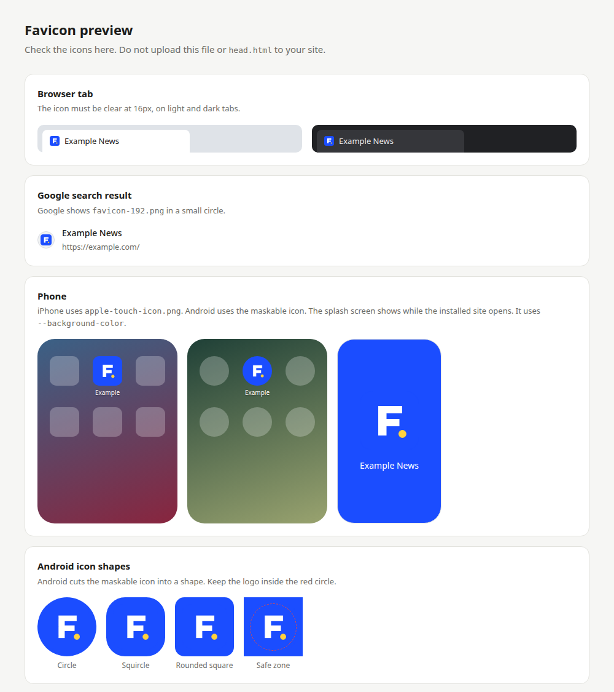

# favicon-maker

[](https://github.com/cybex7/favicon-maker/actions/workflows/test.yml)

Make every favicon your site needs from one image.

You give it one square logo. It gives you:

- all the icon files
- a `site.webmanifest`
- the tags for your `<head>`
- a preview page to check the result

It works offline. Nothing is uploaded.



## Install

You need Python 3.10 or newer.

```bash
pipx install git+https://github.com/cybex7/favicon-maker.git
```

No pipx? Use pip:

```bash
pip install git+https://github.com/cybex7/favicon-maker.git
```

## Quick start

```bash
favicon-maker logo.svg --name "My Site"
```

This makes a `logo-favicons/` folder next to your logo.

Then:

1. Open `preview.html` and check the icons.
2. Copy all files to your site's root folder. Skip `head.html` and `preview.html`.
3. Paste the content of `head.html` into your page's `<head>`.

## Examples

Set the colours:

```bash
favicon-maker logo.png \
  --name "Example News" \
  --short-name "Example" \
  --theme-color "#1b4dff" \
  --background-color "#1b4dff"
```

A right-to-left site, in Persian:

```bash
favicon-maker logo.png \
  --name "پایگاه خبری نمونه" \
  --short-name "نمونه" \
  --lang fa \
  --dir rtl
```

Use `--lang ar --dir rtl` for Arabic, or `--lang he --dir rtl` for Hebrew.

Pick the output folder and make a zip:

```bash
favicon-maker logo.png -o public/icons --zip
```

## Your logo

- **Use SVG if you can.** It stays sharp at every size. You also get a `favicon.svg`.
- **PNG, WebP and JPG work too.** Use 512 × 512 pixels or more. Smaller images work, but large icons look soft. You get a warning.
- **It must be square.** If it is not, the tool stops. Crop it, or add `--pad-to-square`. That puts it in the middle of a clear square.

## What you get

| File | What it is for |
| --- | --- |
| `favicon.ico` | Browser tab. Has 16, 32 and 48 px inside. |
| `favicon.svg` | Browser tab, sharp at any size. Only for an SVG logo. |
| `favicon-192.png` | Google search results and Android. |
| `favicon-512.png` | Android install and splash screen. |
| `favicon-maskable-512.png` | Android. Android cuts it into a circle or other shape. |
| `apple-touch-icon.png` | iPhone and iPad home screen. 180 px. |
| `favicon-57.png` … `favicon-152.png` | Older iPhones and iPads. |
| `apple-touch-icon-precomposed.png` and `apple-touch-icon-120x120*.png` | Some apps look for these names directly. |
| `site.webmanifest` | Name, colours and icons for "Add to Home screen". |
| `head.html` | The tags for your `<head>`. Do not upload it. |
| `preview.html` | Shows how the icons look. Do not upload it. |

Apple and maskable icons get a solid background. It comes from `--background-color`.
iPhones turn clear areas black. Android cuts off the edges of maskable icons.
So these icons also get some padding.

## Options

| Option | Default | What it does |
| --- | --- | --- |
| `-o`, `--out` | `<logo name>-favicons` | Output folder. |
| `--name` | the file name | Full site name. |
| `--short-name` | same as `--name` | Short name under the phone icon. |
| `--theme-color` | `#ffffff` | Colour of the browser bar on phones. |
| `--background-color` | `#ffffff` | Splash screen colour. Also the background of Apple and maskable icons. |
| `--lang` | `en` | Language of the site name. |
| `--dir` | `ltr` | Text direction: `ltr`, `rtl` or `auto`. |
| `--display` | `minimal-ui` | How the installed site opens. `minimal-ui` keeps the back and reload buttons. |
| `--start-url` | `/` | The page the installed site opens. |
| `--padding` | `0` | Space around the logo in normal icons. From 0 to 0.5. |
| `--apple-padding` | `0.08` | Space around the logo in Apple icons. |
| `--maskable-padding` | `0.12` | Space around the logo in the maskable icon. |
| `--pad-to-square` | off | Put a non-square logo in a clear square. |
| `--zip` | off | Also make a zip file. |
| `-f`, `--force` | off | Write into a folder that is not empty. |
| `-V`, `--version` | | Show the version. |

Run `favicon-maker --help` to see them all.

## Run without installing

```bash
git clone https://github.com/cybex7/favicon-maker.git
cd favicon-maker
pip install -r requirements.txt
python3 favicon_maker.py logo.png
```

## Development

```bash
pip install -e ".[test]"
pytest
```

## License

MIT. See [LICENSE](LICENSE).
